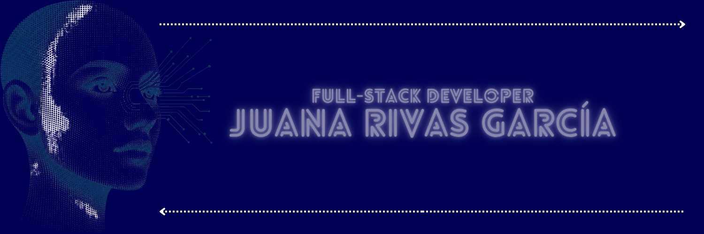

Welcome to my GitHub profile. My name is Juana, and I'm learning full-stack development.

I’m currently working on my own projects, putting what I’m learning into practice. They are designed for everyday life.

Before I began training as a full-stack developer, I earned a bachelor's degree in Pedagogy. By combining these two areas of training with my experience as a freelancer, I write code by understanding what a person needs and turning it into something useful and clear.

## 🛠️ Technologies & Tools

**Languages**
- Python
- SQL

**Databases**
- MySQL
- SQLite

**Tools**
- Linux
- Git

## 📫 Contact

[LinkedIn](https://www.linkedin.com/in/juana-rivas-garcia/)

[Email](mailto:rgjuana@proton.me)

Thanks for visiting my profile! 😊
